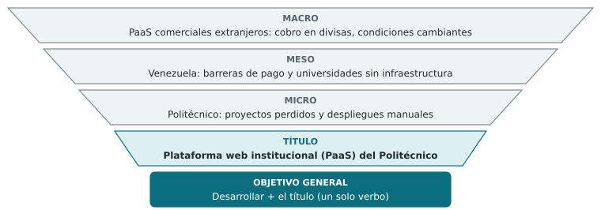
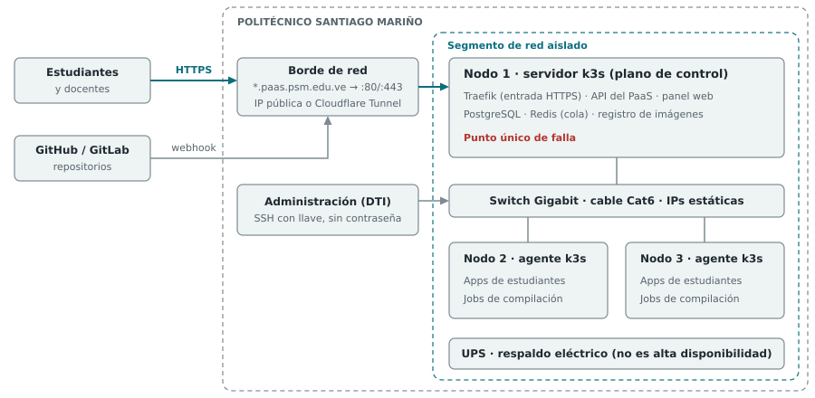
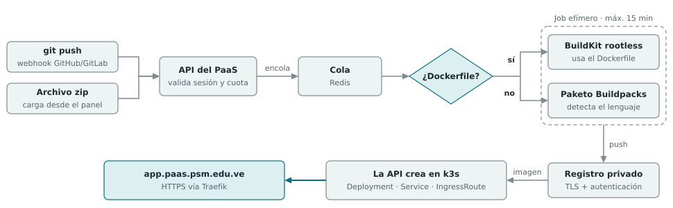
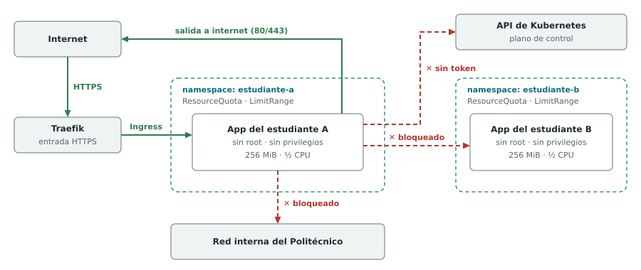
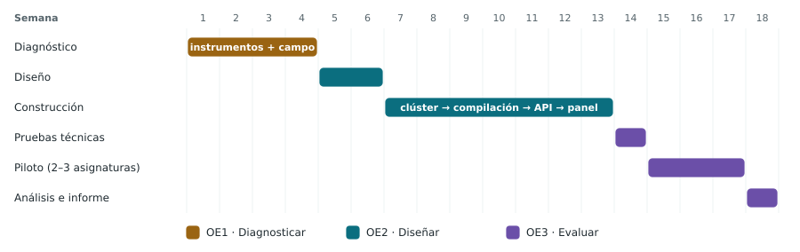

# Plataforma web institucional de alojamiento y despliegue continuo (PaaS) — Documento técnico

> Documento dirigido al **tutor técnico**. Contiene el planteamiento del proyecto, la arquitectura, el cronograma y los indicadores. Los aspectos de forma y método del trabajo de grado se desarrollan en el [documento metodológico](Documento-Metodologico.md).

## Planteamiento del proyecto

> **Título:** *"Plataforma web institucional de alojamiento y despliegue continuo (PaaS) para el Politécnico Santiago Mariño"*

**Problemática:** los estudiantes y docentes del Politécnico Santiago Mariño no cuentan con un espacio institucional para alojar y publicar los proyectos de software que desarrollan en sus asignaturas, y dependen de servicios externos de pago o con planes gratuitos cada vez más limitados.

**Estudio del problema:**

- **Macro:** la enseñanza del desarrollo de software exige publicar aplicaciones en internet, y esa necesidad la cubren sobre todo plataformas comerciales extranjeras (Render, Vercel, Heroku, entre otras). Estos proveedores cobran en divisas, cambian sus condiciones sin aviso (Heroku eliminó su plan gratuito en 2022) y guardan los datos fuera del control de las instituciones educativas.
- **Meso:** en Venezuela se suman barreras propias del país: los pagos internacionales son difíciles, las tarifas en dólares resultan altas para el estudiante y la mayoría de las universidades no tiene infraestructura propia para alojar proyectos estudiantiles. Por eso cada estudiante resuelve el despliegue por su cuenta, con resultados desiguales.
- **Micro:** en el Politécnico Santiago Mariño, los proyectos de distintas materias y niveles de complejidad se alojan en cuentas personales de servicios externos. Esas cuentas vencen y los proyectos se pierden al terminar el período. Los docentes tampoco tienen un punto único para revisar las versiones desplegadas, y cada estudiante pierde horas configurando despliegues manualmente.

**Título → solución:** del estudio anterior surge el título, una plataforma institucional propia que resuelve el alojamiento y el despliegue de los proyectos académicos dentro de la infraestructura del Politécnico.

*Figura 1. Del problema al título. El estudio macro, meso y micro converge en el título, y el título en infinitivo es el objetivo general.*

- **Objetivo general:** Diseñar una plataforma web institucional de alojamiento y despliegue continuo (PaaS) para el Politécnico Santiago Mariño.
- **Objetivos específicos:**
    1. Diagnosticar las necesidades de alojamiento y despliegue de proyectos académicos de los estudiantes y docentes.
    2. Definir la arquitectura de la plataforma web de alojamiento y despliegue continuo, con aislamiento por contenedores y límites de recursos.
    3. Evaluar la factibilidad técnica, operativa y económica de la plataforma.

> **Pendiente de realinear (2026-10-04):** al cambiar el objetivo general a *Diseñar*, el proyecto llega hasta la demostración de factibilidad (prueba de concepto en laboratorio, validación por expertos y estudio de costos). El piloto con asignaturas pasa a recomendaciones. El cronograma, el alcance y los indicadores de este documento todavía reflejan el plan anterior con piloto y deben ajustarse.
- **Pregunta de investigación:** ¿en qué medida es factible, técnica, operativa y económicamente, una plataforma institucional de alojamiento que permita a estudiantes y docentes del Politécnico Santiago Mariño desplegar sus proyectos académicos sin depender de servicios externos de pago?

## Enfoque metodológico

- **Modalidad:** proyecto factible, es decir, la propuesta de un modelo operativo viable que resuelve una necesidad concreta de una institución. Se apoya en una investigación de campo (diagnóstico en el Politécnico) y documental (antecedentes y bases teóricas). La modalidad exacta debe confirmarse con el manual de Trabajos de Grado del Politécnico.
- **Fases de la investigación:** cada fase responde a un objetivo específico: **diagnóstico** (OE1), **diseño** (OE2) y **evaluación de factibilidad** (OE3). La construcción del prototipo no es un fin en sí misma; es el medio para evaluar la propuesta con datos reales.
- **Población y muestra:** estudiantes y docentes de las asignaturas de programación y desarrollo de software del Politécnico, más el personal del departamento de tecnología. La muestra es intencional: se escogen las secciones que participarán en el piloto.
- **Instrumentos:**
    - Cuestionario a estudiantes (escala Likert y preguntas cerradas sobre servicios usados, gasto, pérdida de proyectos y tiempo invertido en desplegar).
    - Cuestionario o entrevista a docentes (cómo reciben y revisan los proyectos desplegados).
    - Entrevista semiestructurada al departamento de tecnología (red, IP pública, DNS, energía, espacio físico y políticas de uso). Incluye una pregunta sobre **qué distribuciones de Linux administra el departamento y con cuáles tiene experiencia**, en particular la familia Red Hat (AlmaLinux, Rocky Linux) frente a la familia Debian (Debian, Ubuntu). La respuesta pesa en la elección final del sistema operativo, porque la factibilidad operativa depende de quién mantendrá la plataforma.
    - Ficha de observación de la infraestructura disponible.
- **Validez y confiabilidad:** validación de los instrumentos por juicio de tres expertos, prueba previa del cuestionario y cálculo del coeficiente Alfa de Cronbach.
- **Evaluación según Sapag Chain:**
    - **Estudio técnico:** capacidad del clúster, pruebas de carga y de aislamiento.
    - **Estudio económico:** inversión y costos de operación frente al costo evitado de los servicios externos, expresado como relación beneficio-costo.
    - **Estudio organizacional y legal:** quién administra la plataforma, reglamento de uso aceptable y tratamiento de los datos de los usuarios.

## Arquitectura propuesta (base para el OE2)

Los tres nodos se instalan en las instalaciones del Politécnico (laboratorio o cuarto de servidores), en un segmento de red asignado por el departamento de tecnología.

| Componente | Ubicación | Función |
|---|---|---|
| Nodo 1: servidor k3s | Equipo HP 1 | Plano de control de Kubernetes, Traefik (incluido en k3s en su versión 2 o 3), API del PaaS, PostgreSQL (datos de la plataforma), Redis (cola de tareas) y registro privado de imágenes |
| Nodos 2 y 3: agentes k3s | Equipos HP 2 y 3 | Aplicaciones de los estudiantes y trabajos de compilación |
| Red | Switch Gigabit, cable Cat6 | IPs estáticas en un segmento aislado de la red administrativa; administración por SSH con autenticación por llave (sin contraseña), solo desde equipos autorizados |
| Energía | UPS | Respaldo eléctrico para los tres nodos y el switch. Es respaldo eléctrico, **no alta disponibilidad**: el nodo 1 es un punto único de falla y se documenta como limitación |
| Sistema operativo | Los tres nodos | AlmaLinux 9 o Rocky Linux 9 (familia Red Hat), instalación mínima sin interfaz gráfica y con SELinux activo. Se confirma en el diagnóstico (ver abajo) |

*Figura 2. Topología física. Los tres nodos están en un segmento aislado de la red del Politécnico. El tráfico HTTPS (en color) entra por el borde de red hasta Traefik en el nodo 1, que lo reparte a las apps de los nodos 2 y 3 a través del switch.*

**Sistema operativo de los nodos**

- **Elección: AlmaLinux 9 o Rocky Linux 9.** Las dos son distribuciones compatibles con Red Hat Enterprise Linux y reciben actualizaciones de seguridad hasta el 31 de mayo de 2032. Con eso, la plataforma no necesita actualizaciones de versión mayor del sistema durante la investigación ni durante varios períodos académicos posteriores.
- **Por qué no Fedora:** comparte las mismas herramientas (dnf, SELinux, firewalld), pero cada versión recibe actualizaciones solo unos 13 meses. Obligaría a actualizar la versión mayor de los tres nodos aproximadamente una vez al año, con el clúster en producción.
- **Por qué no Ubuntu o Debian:** son igualmente válidas para k3s. Se prefiere la familia Red Hat por el dominio del autor y por SELinux, que añade una capa de aislamiento obligatorio entre los contenedores y el sistema anfitrión.
- **Decisión final:** depende de la entrevista al departamento de tecnología. Si este administra otra familia de distribuciones, se adopta esa, porque es quien mantendrá la plataforma. Se documenta en la fase de alternativas de solución, con criterios explícitos: ciclo de soporte, compatibilidad con k3s, seguridad y dominio del equipo administrador.
- **Preparación para k3s en la familia Red Hat** (según la documentación oficial de k3s):
    - **firewalld:** desactivarlo o abrir el puerto 6443/tcp y declarar como zona de confianza las redes de pods (10.42.0.0/16) y de servicios (10.43.0.0/16). Se prefiere mantenerlo activo con esas reglas, en coherencia con el modelo de seguridad.
    - **SELinux:** instalar el paquete `k3s-selinux` y ejecutar k3s con soporte de SELinux (`--selinux`), sin desactivarlo.
    - **Verificar al implementar** los requisitos de la versión de k3s vigente en ese momento.

**Exposición a internet y dominio (`*.paas.psm.edu.ve`)**

- **Vía principal:** el Politécnico provee una IP pública y reenvía los puertos 80 y 443 hacia Traefik. El subdominio `paas.psm.edu.ve` se delega a un proveedor de DNS con API (por ejemplo, el plan gratuito de Cloudflare) para que cert-manager emita un **certificado comodín de Let's Encrypt mediante validación por DNS (DNS-01)**, que es la única validación que Let's Encrypt admite para comodines.
- **Contingencia:** si el Politécnico no dispone de IP pública, se usa Cloudflare Tunnel. En ese caso el HTTPS público lo termina Cloudflare y cert-manager no es necesario para los certificados públicos.
- La vía se decide en el diagnóstico, porque depende de la infraestructura del Politécnico y de la autorización de su departamento de tecnología.

**Motor de compilación**

- **Fuentes de código:** repositorio de GitHub o GitLab (un webhook dispara la compilación en cada `push`) o carga de un archivo zip desde el panel.
- **Detección automática:** si el proyecto trae `Dockerfile`, se compila con **BuildKit en modo sin privilegios (rootless)**. Si no lo trae, **Paketo Buildpacks** detecta el lenguaje (`package.json`, `requirements.txt`, `go.mod`, etc.) y genera la imagen sin necesidad de Dockerfile.
- **Ejecución:** cada compilación corre como un *Job* efímero de Kubernetes en los nodos agentes, con límite de tiempo (15 minutos) y de recursos. No se usa Kaniko, porque Google lo archivó en 2025; esto debe verificarse al momento de implementar.
- **Registro de imágenes:** registro privado dentro del clúster, con TLS y autenticación, declarado en `registries.yaml` de k3s.
- **Cola de tareas:** Redis con BullMQ o Celery (según el lenguaje del backend), para que las compilaciones no bloqueen la API.
- **Flujo:** fuente → cola → compilación → registro → manifiestos → despliegue en k3s.

**Orquestación de aplicaciones**

Por cada aplicación, la API genera tres recursos en k3s:

- **Deployment:** contenedor, variables de entorno y límites de recursos (por defecto 256 MiB de RAM y medio núcleo de CPU).
- **Service:** expone el puerto interno del contenedor dentro del clúster.
- **IngressRoute de Traefik:** dirige `app.paas.psm.edu.ve` hacia su Service.

Las variables de entorno se guardan como *Secrets* de Kubernetes, no en texto plano.

*Figura 3. Flujo de despliegue. El código llega por webhook o por zip, la API lo encola y un Job efímero lo compila con BuildKit (si hay Dockerfile) o con Buildpacks (si no lo hay). La imagen pasa al registro privado y la API crea los tres recursos en k3s.*

**Seguridad y aislamiento (núcleo del capítulo de diseño)**

La plataforma ejecuta código de terceros, así que este es el mayor riesgo técnico del proyecto.

- **Un namespace por usuario**, con *ResourceQuota* y *LimitRange* para que nadie consuma más de su cuota.
- **NetworkPolicy que niega todo el tráfico por defecto:** una app no puede comunicarse con las de otros usuarios, ni con la red interna del Politécnico, ni con el plano de control. Solo se permite la salida a internet por los puertos necesarios. k3s trae un controlador de NetworkPolicy integrado.
- **Pod Security Admission en nivel `restricted`:** los contenedores corren sin root, sin modo privilegiado, sin acceso al disco del nodo y sin capacidades extra del kernel.
- **SELinux en modo obligatorio (*enforcing*) en los nodos:** aunque un contenedor lograra escapar de su aislamiento, la política de SELinux limita lo que puede hacer sobre el sistema anfitrión.
- **Sin credenciales del clúster dentro de las apps:** `automountServiceAccountToken: false`.
- **Límites de uso:** número máximo de apps y de despliegues por usuario, y límite de peticiones a la API.
- **Escaneo de imágenes con Trivy** (opcional, si el cronograma lo permite).
- **Reglamento de uso aceptable** aprobado por el Politécnico (prohíbe minería de criptomonedas, envío masivo de correo y contenido ilícito) y un mecanismo de suspensión de apps.

*Figura 4. Modelo de aislamiento. En verde, el único tráfico permitido: entrada por Traefik y salida a internet. En rojo, lo que bloquean NetworkPolicy y la ausencia de credenciales: otros estudiantes, la API de Kubernetes y la red interna del Politécnico.*

**Autenticación y roles**

- **Inicio de sesión con la cuenta institucional:** OAuth/OIDC si el Politécnico usa Google Workspace o Microsoft 365; si no, registro con correo institucional verificado.
- **Roles:**
    - **Estudiante:** despliega proyectos dentro de las asignaturas en las que está inscrito.
    - **Docente:** crea su asignatura o sección, aprueba a sus estudiantes y consulta sus despliegues y logs.
    - **Administrador** (departamento de tecnología): cuotas, suspensiones y mantenimiento.
- **Ciclo de vida:** los proyectos quedan ligados al período académico. Al cierre se detienen y se archivan (imagen y metadatos), sin borrarlos. Esto responde directamente al problema de los proyectos perdidos.

**Panel web y monitoreo**

- Crear un proyecto a partir de la URL del repositorio o de un zip, y gestionar sus variables de entorno.
- Ver los logs de compilación y de ejecución en tiempo real mediante SSE, conectado a la API de Kubernetes.
- Ver el estado de cada app y gráficas básicas de RAM y CPU obtenidas de metrics-server (incluido en k3s).

**Capacidad del piloto**

La capacidad se calcula en el diagnóstico con las especificaciones reales de los equipos HP:

> Apps simultáneas ≈ (RAM de los nodos agentes − reserva del sistema) ÷ 256 MiB

Por ejemplo, con dos agentes de 16 GB y 2 GB de reserva cada uno: (32 − 4) GB ÷ 0,25 GB ≈ 110 apps. Esta es una cota superior; en la práctica hay que restar la memoria que usan las compilaciones.

## Cronograma (18 semanas)

| Semanas | Fase | Objetivo | Actividades | Entregable |
|---|---|---|---|---|
| 1–2 | Diagnóstico | OE1 | Revisión documental y antecedentes; diseño de instrumentos y validación por juicio de expertos | Instrumentos validados |
| 3–4 | Diagnóstico | OE1 | Aplicación de cuestionarios y entrevistas; relevamiento de infraestructura del Politécnico (red, IP pública, DNS, energía, equipos); análisis de resultados | Informe de diagnóstico y requisitos |
| 5–6 | Diseño | OE2 | Arquitectura, modelo de seguridad, modelo de datos y roles; estimación preliminar de costos | Documento de diseño |
| 7–8 | Construcción | OE2 | Clúster de 3 nodos operativo; dominio, HTTPS y Traefik respondiendo | Clúster accesible por HTTPS |
| 9–10 | Construcción | OE2 | Motor de compilación (Buildpacks, BuildKit, registro, cola) desde repositorio o zip | Imagen compilada automáticamente |
| 11–12 | Construcción | OE2 | API con manifiestos dinámicos, aislamiento (namespaces, cuotas, NetworkPolicy), autenticación y roles | Despliegue de extremo a extremo |
| 13 | Construcción | OE2 | Panel web, logs en tiempo real y métricas | Plataforma lista para el piloto |
| 14 | Evaluación | OE3 | Pruebas de carga, de aislamiento y de seguridad; correcciones | Informe de pruebas técnicas |
| 15–17 | Evaluación | OE3 | Piloto con 2–3 asignaturas; registro de indicadores; encuesta de satisfacción al cierre | Datos del piloto |
| 18 | Evaluación | OE3 | Análisis de indicadores, estudio económico final y conclusiones | Informe final |

*Figura 5. Cronograma de 18 semanas por objetivo específico. La construcción ocupa 7 semanas; el diagnóstico y la evaluación ocupan 8.*

**Regla de recorte:** la hoja de ruta técnica original asignaba 10 semanas a la construcción; aquí se reduce a 7 para dar espacio al diagnóstico y a la evaluación. Si la construcción se atrasa, se simplifica el panel (se deja solo el estado y los logs). No se recortan el diagnóstico, las pruebas de seguridad ni el piloto, porque son los que sostienen los objetivos 1 y 3.

## Alcance, indicadores y viabilidad

- **Alcance:**
    - Clúster k3s de 3 nodos en las instalaciones del Politécnico.
    - Despliegue desde un repositorio de GitHub o GitLab (webhook en cada `push`) o desde un zip, con `Dockerfile` o con detección automática por Buildpacks. Node, Python, Go y sitios estáticos tienen soporte oficial; los demás lenguajes de Paketo funcionan sin garantía.
    - Subdominio HTTPS por aplicación, variables de entorno, logs en tiempo real y métricas básicas.
    - Aislamiento, cuotas, autenticación institucional y roles.
    - Piloto de 3 semanas con 2–3 asignaturas.
- **Fuera de alcance:** bases de datos gestionadas; alta disponibilidad del plano de control (hay un solo nodo servidor); facturación; flujos CI/CD complejos (pruebas automáticas, entornos de vista previa); aislamiento reforzado con máquinas virtuales ligeras (gVisor o Kata Containers); escalado automático; dominios personalizados.
- **Indicadores de evaluación:**
    - **Técnicos:** tasa de despliegues exitosos, tiempo promedio de compilación y despliegue frente al proceso manual, disponibilidad durante el piloto (% del tiempo en línea), uso de recursos por aplicación, incidentes de seguridad registrados y resultado de las pruebas de aislamiento.
    - **Operativos:** número de proyectos alojados y de usuarios activos, y satisfacción de estudiantes y docentes (encuesta posterior al piloto).
    - **Económicos:** relación beneficio-costo y % de reducción de costo frente a los servicios externos.
- **Métrica de viabilidad (costo-beneficio):** no se mide en ventas. Se comparan la inversión (equipos, switch, UPS) y los costos de operación en el Politécnico (energía, conectividad, horas de administración) con lo que pagarían estudiantes y docentes por servicios externos, más las horas ahorradas en configurar despliegues manualmente. El resultado se expresa como relación beneficio-costo, siguiendo a Sapag Chain.
- **Base técnica de partida:** ninguna existente. Es desarrollo nuevo, apoyado en la experiencia ya adquirida en despliegue y orquestación de servidores y en una hoja de ruta técnica preliminar, ya revisada y ajustada en este documento.
